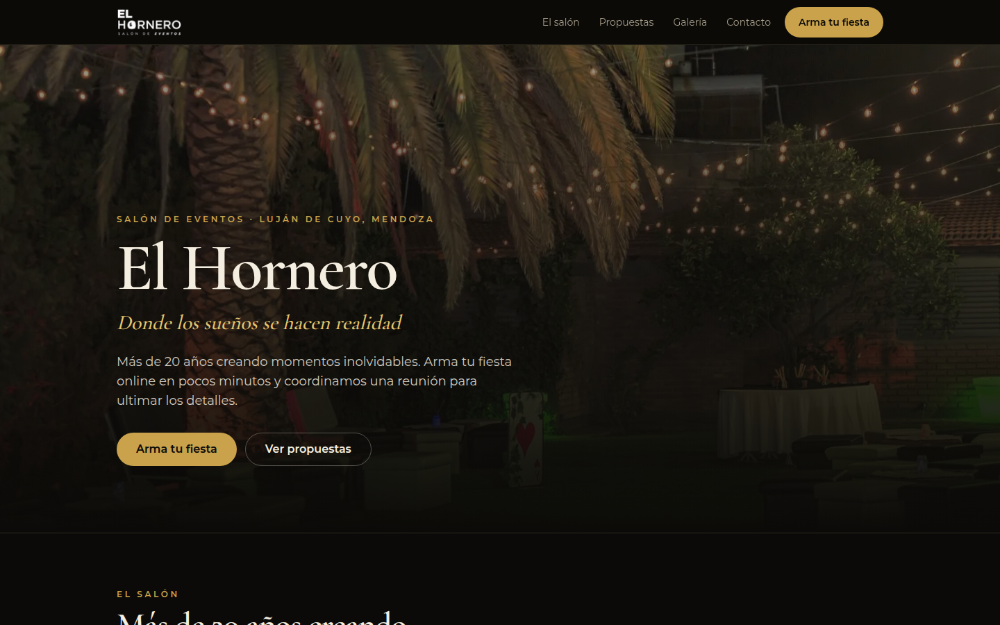
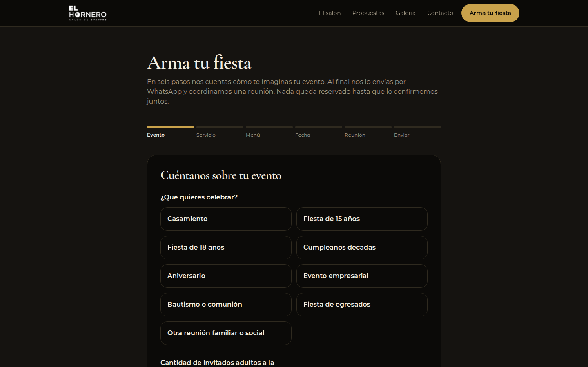

# El Hornero · Salón de eventos

Sitio en producción para un salón de eventos de Mendoza: la persona arma su fiesta en pocos pasos, consulta la disponibilidad de la fecha y envía el pedido por WhatsApp con un resumen en PDF. El salón gestiona las consultas desde un panel propio.

**Demo:** https://elhornero-eventos.vercel.app



## Funcionalidades

- Armado del evento en seis pasos (tipo de evento, servicio, menú, fecha, reunión y envío), validado con Zod en el cliente y en el servidor.
- Consulta de disponibilidad de fechas, con feriados provinciales y fechas bloqueadas por el salón.
- Envío del pedido por WhatsApp con un link al PDF del resumen, generado en el servidor.
- Panel del salón con contraseña: consultas, estados, notas internas, reunión acordada e historial de actividad.
- Calendario del panel para bloquear y desbloquear fechas, y gráfico de consultas por mes.
- Páginas por tipo de evento, galería, preguntas frecuentes, datos estructurados, sitemap y robots para SEO.
- Agenda opcional con Google Calendar; sin credenciales usa una agenda simulada.



## Stack

Next.js 16 (App Router, Server Actions) · React 19 · TypeScript · Tailwind CSS 4 · React Hook Form · Zod · Postgres (Neon) · jsPDF · Google Calendar API · Vercel

## Correrlo en local

```bash
cp .env.example .env.local   # completar contraseña y clave del panel
npm install
npm run dev                  # http://localhost:3000
```

Sin `DATABASE_URL`, las consultas se guardan en `.data/` (solo para desarrollo). Los teléfonos del salón no están en el repositorio: se cargan con `NEXT_PUBLIC_WHATSAPP_NUMBER` y `NEXT_PUBLIC_SALON_PHONES`.

## Estructura

```
app/(sitio)/     sitio público: inicio, armado de la fiesta, páginas por evento
app/panel/       panel del salón (protegido por sesión)
app/api/         disponibilidad de fechas
features/        lógica por dominio: catálogo, disponibilidad, consultas, sesión del panel
public/          fotos y video del salón
docs/            guía técnica y capturas
```

Más detalle en [docs/guia-tecnica.md](docs/guia-tecnica.md).

---

Desarrollado por [Tobias Rivas](https://tobias-rivas.vercel.app). Fotos, video y marca pertenecen a El Hornero y se publican con su autorización.
